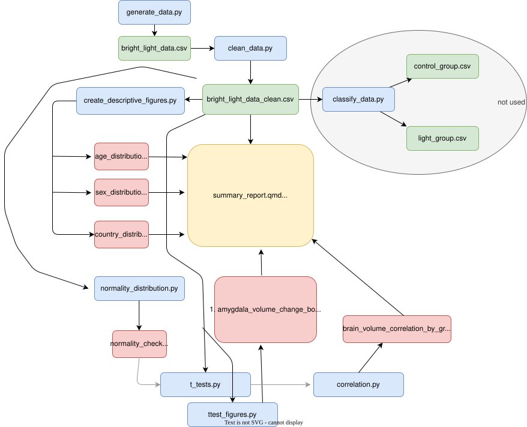

# Bright-Light Therapy — Brain Volume Analysis

This document provides structured documentation for the bright-light therapy brain volume project, completed as part of the open science course at KI. [Course link](https://k-cir.github.io/course-open-science-in-practice/)

## Introduction

This project investigates changes in hippocampal and amygdala volume following an eight-week bright-light therapy study. Participants were randomly assigned to a control group or a bright-light group. MRI measurements were collected before and after the intervention.

## Workflow



## Folder structure

The `data/` folder contains the raw data `.csv` file as well as the cleaned dataset. The `scripts/` folder contains all python scripts neccesary for running the analysis. The `figures/` folder contains all generated figures. The `summary_report.qmd` file is located in the project root.

### `data/`
- `bright_light_data.csv` — raw dataset
- `bright_light_data_clean.csv` — cleaned dataset (76 participants, 38 per group)

### `scripts/`

`clean_data.py` reads the raw dataset and removes participants with missing post-treatment hippocampal volume measurements (n = 3) and one participant with unrealistically high hippocampal values.

`create_descriptive_figures.py` generates demographic figures: age distribution, sex distribution, and country distribution by group.

`descriptive_stats.py` computes descriptive statistics for the cleaned sample, including age, sex, and country of origin by group.

`t_tests.py` computes hippocampal and amygdala volume change scores (post minus baseline), and runs paired and Welch's independent t-tests for both brain regions.

`ttest_figures.py` generates plots of hippocampal and amygdala volume change by group.

`correlation.py` computes Pearson's correlation between hippocampal and amygdala volume changes and produces a scatter plot coloured by group.

## Libraries needed

Python is used throughout the entirety of this project. Essential Python packages are:
- `pandas`
- `scipy`
- `matplotlib`
- `seaborn`

Install all at once:
```bash
pip install pandas scipy matplotlib seaborn
```

## Usage

Run each script separately from the `scripts/` folder:

```bash
cd scripts
python3 clean_data.py
python3 descriptive_stats.py
python3 create_descriptive_figures.py
python3 t_tests.py
python3 ttest_figures.py
python3 correlation.py
```

Then render the report from the project root:

```bash
quarto render summary_report.qmd
```